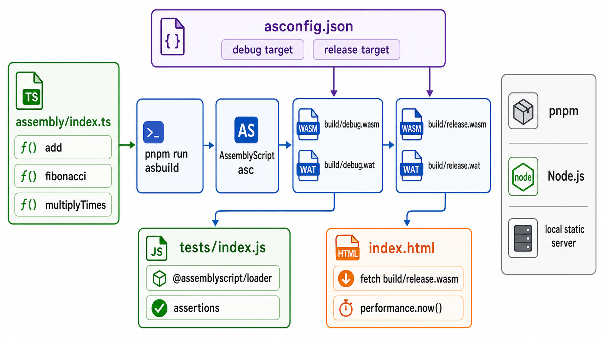

<!-- archive-repo:deprecation-notice:start -->
> [!WARNING]
> **Deprecated**
>
> The advent of agents has made AssemblyScript less relevant.
<!-- archive-repo:deprecation-notice:end -->

<p align="center">
  
  <br />
  <!-- repo-tagline:start -->
  <strong>⚡ Sandbox for experimenting with AssemblyScript and WebAssembly 🕸️</strong>
  <!-- repo-tagline:end -->
</p>

sandbox-assemblyscript is a small AssemblyScript project that compiles typed arithmetic functions to WebAssembly. It includes Node.js tests for the debug and release builds, plus a browser demo that compares JavaScript and WebAssembly timing.

Use it as a minimal reference for compiling AssemblyScript, loading `.wasm` files from JavaScript, and checking the generated output in both Node.js and the browser.

## Install

```bash
git clone https://github.com/tsilva/sandbox-assemblyscript.git
cd sandbox-assemblyscript
pnpm install --frozen-lockfile --ignore-scripts
pnpm run asbuild
pnpm test
pnpm run serve
```

Open [http://localhost:3000](http://localhost:3000).

## Commands

```bash
pnpm run asbuild          # build debug and release WASM output
pnpm run asbuild:debug    # build build/debug.wasm and build/debug.wat
pnpm run asbuild:release  # build build/release.wasm and build/release.wat
pnpm test                 # verify runner failure handling and both WASM outputs
pnpm run serve            # serve index.html and local demo assets
```

## Notes

- `package.json` pins pnpm 10.27.0; `pnpm-lock.yaml` records the dependency graph.
- Installs keep lifecycle scripts disabled, enforce a seven-day release age, and block exotic transitive sources.
- This sandbox runs from its WASM builds and browser page; it does not declare a Node package entry point.
- Run `pnpm run asbuild` before `pnpm test` or the browser demo so `build/*.wasm` exists.
- CI installs the frozen pnpm lock, builds both targets, verifies test failure propagation, runs the WASM assertions and audits dependencies.
- `tests/index.js` loads WASM synchronously with `fs.readFileSync` and instantiates it with `@assemblyscript/loader`.
- `index.html` imports `@assemblyscript/loader` from `node_modules`, so the demo should be opened through the local static server.
- Secret scanning normally checks the push/PR commit range. If a rewritten push tip is unavailable in a full checkout, it scans all history reachable from the new tip; missing PR bases and shallow fallback histories still fail.

## Architecture



## License

[MIT](LICENSE)
